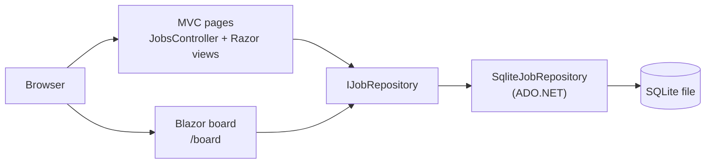

# Job Application Tracker

A small web app for tracking job applications from first interest through offer. It is built with
**C# on .NET 10**, mixing **ASP.NET Core MVC** for the page-based screens with an interactive
**Blazor** board, and it stores data in SQLite using plain **ADO.NET** (no Entity Framework).

## Features

- **List** (`/`): search by company or title, filter by status, and see which follow-ups are due.
- **Add, edit and delete** applications with server-side validation and anti-forgery protection (MVC).
- **Board** (`/board`): a column per stage, with buttons to move an application between stages
  without a page reload (Blazor Server).
- Statuses: Wishlist, Applied, Phone screen, Interview, Offer, Rejected.

## Architecture



| Folder | What it holds |
| --- | --- |
| `src/JobTracker.Web/Models` | `JobApplication`, `JobStatus`, and the list page's view model |
| `src/JobTracker.Web/Data` | `IJobRepository` and the SQLite implementation |
| `src/JobTracker.Web/Controllers`, `Views` | The MVC screens |
| `src/JobTracker.Web/Components` | The Blazor app shell, layout, and board page |
| `tests/JobTracker.Tests` | xUnit tests that run the real SQL against a temporary SQLite file |

## Design decisions

- **No ORM.** Every query is hand-written SQL with parameters (`$company`, `$id`, ...), so user text
  is never concatenated into SQL. The whole data layer is one readable file.
- **A repository interface.** Controllers and components depend on `IJobRepository`, not on SQLite,
  so the storage can be swapped (for example to Azure SQL) without touching the UI.
- **One shared, stateless repository.** Each call opens a short-lived connection, so a single
  instance is safe for MVC requests and for long-lived Blazor Server circuits. With Entity Framework
  you would need a `DbContext` factory in Blazor Server to avoid stale, long-lived contexts.
- **MVC and Blazor side by side.** MVC handles plain forms and lists. Blazor handles the one screen
  that benefits from interactivity. Both use the same repository and the same stylesheet.
- **LIKE wildcards are escaped**, so searching for `100%` or `a_b` matches those characters literally.
- **Dates are stored as ISO text** (`2026-10-22`), which sorts correctly as plain text in SQLite.

## Run it

You need the [.NET 10 SDK](https://dotnet.microsoft.com/download).

```bash
dotnet run --project src/JobTracker.Web
```

Open the address it prints (the `http` profile uses `http://localhost:5080`). The database file is
created on first run at `src/JobTracker.Web/App_Data/jobtracker.db` and is ignored by Git.

To fill the app with sample data for a demo:

```bash
dotnet run --project src/JobTracker.Web --SeedDemoData=true
```

The seed only runs when the table is empty, and it is off by default so your real applications are
never mixed with sample ones.

## Test it

```bash
dotnet test
```

The tests use the real SQL against a throwaway SQLite file, so they catch mistakes in the queries as
well as in the logic.

## Continuous integration

`.github/workflows/ci.yml` restores, builds, and tests on every push to `main` and on every pull request.

## Roadmap

1. Dockerfile and a container run.
2. Azure resources defined in Bicep.
3. Deploy workflow using GitHub OIDC (no stored secrets).
4. A scheduled Azure Function that emails a daily follow-up list.
5. Application Insights monitoring and alerts.
